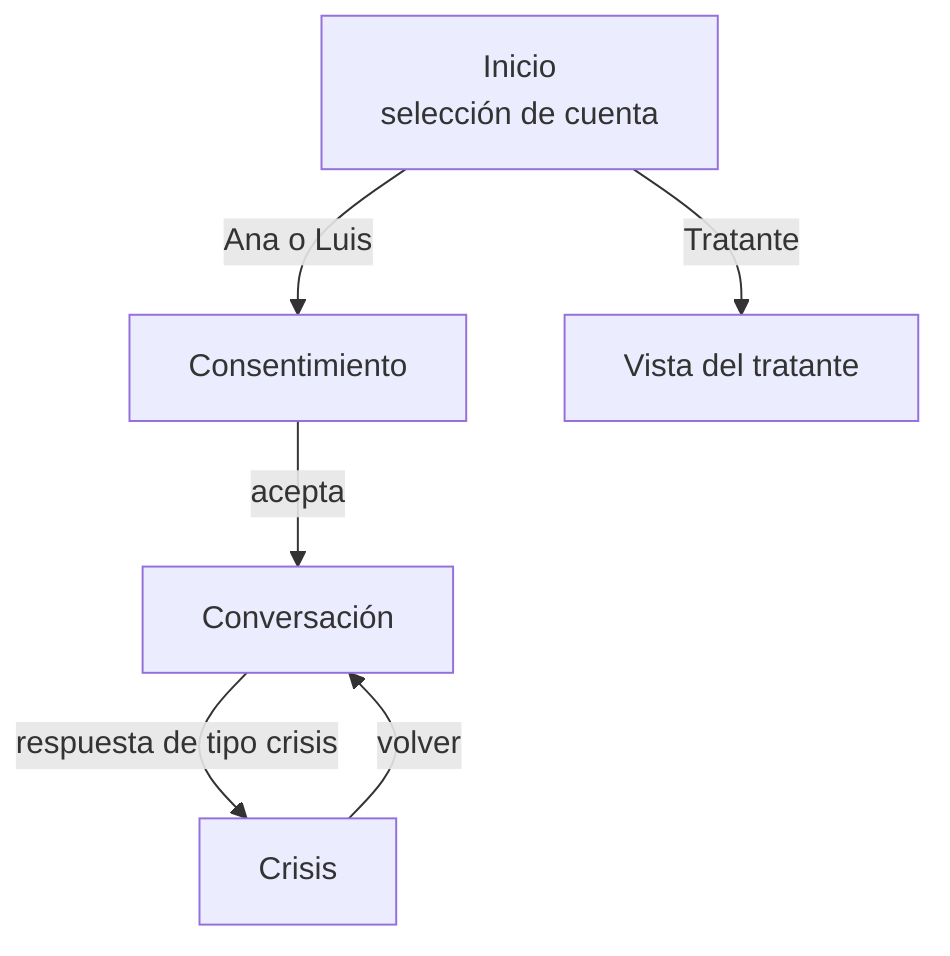

# Pantallas y navegación

El presente documento describe las pantallas de la primera entrega, su navegación y los endpoints que emplea cada una.

## Flujo de navegación

## Pantallas

| Pantalla | Ruta | Archivo | Historia | Endpoints |
| --- | --- | --- | --- | --- |
| Inicio | `/` | `features/inicio/inicio_screen.dart` | | Ninguno |
| Consentimiento | `/consentimiento` | `features/consentimiento/consentimiento_screen.dart` | HU-02 | `POST /consentimiento` |
| Conversación | `/chat` | `features/chat/chat_screen.dart` | HU-05 | `GET /chat/historial`, `POST /chat` |
| Crisis | `/crisis` | `features/crisis/crisis_screen.dart` | HU-15 | Ninguno; recibe los datos de `POST /chat` |
| Vista del tratante | `/tratante` | `features/tratante/tratante_screen.dart` | HU-18 | `GET /tratante/paciente`, `POST /resumen` |

## Comportamiento esperado

### Inicio

Permite elegir una de las tres cuentas de demostración. Existe únicamente en la primera entrega, en reemplazo del inicio de sesión.

### Consentimiento

- Presenta el texto del consentimiento informado, que debe indicar que Holo no reemplaza a un profesional ni a un servicio de emergencia.
- Incluye una casilla de declaración de mayoría de edad y otra de aceptación.
- El botón de continuar permanece deshabilitado hasta marcar ambas casillas.
- Al continuar, envía `POST /consentimiento` y navega a la conversación.

### Conversación

- Al abrirse, carga el historial con `GET /chat/historial`.
- Los mensajes del usuario se alinean a la derecha y los del asistente a la izquierda.
- Mientras se espera la respuesta, muestra un indicador y deshabilita el envío.
- Si la respuesta tiene `tipo` igual a `crisis`, navega a la pantalla de crisis con el texto y los recursos recibidos.
- Los recursos de ayuda deben ser accesibles desde esta pantalla en todo momento, incluso si el backend no responde.
- Ante un error de conexión, informa al usuario con un mensaje claro y permite reintentar.

### Crisis

- Muestra el texto fijo y los recursos de ayuda tal como los devuelve el backend.
- Cada recurso ofrece un botón para iniciar la llamada.
- No ofrece técnicas ni sugerencias.

### Vista del tratante

- Muestra el nombre del paciente vinculado, sus alertas y el último resumen.
- Permite generar un resumen nuevo.
- Indica de forma visible que el resumen fue generado por inteligencia artificial.
- No muestra la conversación del paciente.

## Lineamientos de interfaz

- Lenguaje sencillo, en español de Ecuador.
- Textos legibles en un teléfono: tamaño de fuente no menor a 14 puntos.
- Tema basado en el color `#25706A`, definido en `lib/app.dart`.
- Los estados de carga, vacío y error se diseñan para cada pantalla.
